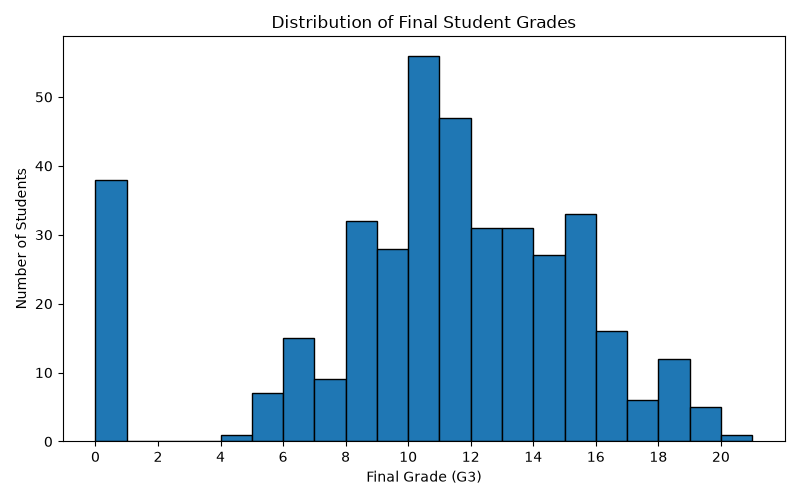
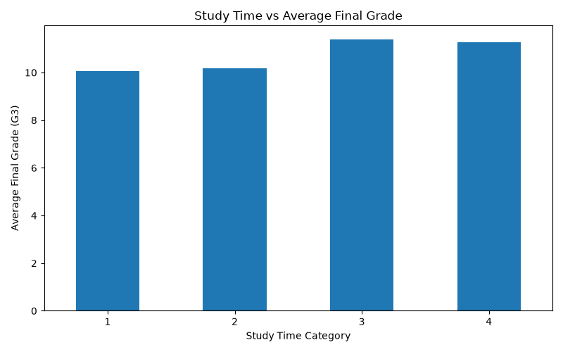

# 🎓 Student Performance Prediction

### An End-to-End Machine Learning Project for Academic Performance Analysis and Prediction

<p align="left">
  
  
  
  
  
  
</p>

## 📌 Project Overview

**Student Performance Prediction** is a machine learning project designed to analyze student-related data, discover patterns in academic performance, and predict students' final grades.

The project combines exploratory data analysis, machine learning model training, model comparison, cross-validation, hyperparameter tuning, and an interactive web application built with Streamlit.

The objective is to transform student data into meaningful insights while exploring how machine learning can support academic performance analysis.

The project also emphasizes model evaluation and visualization, making it easier to understand the data, examine model performance, and interact with predictions.

### 🎯 Key Objectives

- Analyze student datasets to identify patterns associated with academic performance.
- Explore the distribution of final grades and relationships between student features.
- Develop machine learning models for academic performance prediction.
- Compare models using appropriate evaluation methods.
- Assess model reliability through cross-validation.
- Explore potential improvements through hyperparameter tuning.
- Provide an interactive interface for making predictions.

---

## ✨ Key Features

| Feature | Description |
|---|---|
| Exploratory Data Analysis | Explore student data, distributions, and feature relationships. |
| Grade Distribution Analysis | Visualize the distribution of students' final grades. |
| Study Time Analysis | Examine average final grades across study-time categories. |
| Model Training | Train a machine learning model using student-related features. |
| Model Comparison | Compare candidate models using evaluation results. |
| Cross-Validation | Assess model consistency across different data splits. |
| Hyperparameter Tuning | Test parameter configurations to investigate potential performance improvements. |
| Prediction Workflow | Generate predictions using the trained model. |
| Interactive Web Application | Access the prediction interface through Streamlit. |

---

## 🛠️ Tech Stack

| Technology | Application |
|---|---|
| Python | Core programming and model development |
| Pandas | Data manipulation and analysis |
| NumPy | Numerical computing |
| Scikit-learn | Machine learning, model evaluation, and validation |
| Matplotlib | Data visualization |
| Seaborn | Statistical data visualization |
| Streamlit | Interactive web application |
| Joblib | Model and object serialization, where used |

---

## 📊 Exploratory Data Analysis

Exploratory Data Analysis (EDA) helps identify patterns in student data before interpreting model predictions.

### 1. Distribution of Final Student Grades



**What this visualization shows**

This histogram displays the distribution of final grades, represented by `G3`, in the dataset.

It helps examine:

- The range of observed final grades.
- Grade concentrations and less frequent outcomes.
- The overall distribution of student performance.
- Potential patterns that may require further investigation.

**Why it matters:** Understanding the target variable helps inform model selection, evaluation, and interpretation of prediction errors.

### 2. Study Time vs Average Final Grade



**What this visualization shows**

This bar chart compares average final grades across study-time categories.

It helps explore whether average academic outcomes differ across the reported study-time groups.

**Why it matters:** Visualizing feature relationships provides an initial understanding of the data and can help guide subsequent model development.

> **Interpretation note:** These visualizations describe patterns in the observed dataset. They do not establish causation or prove that study time alone determines academic performance.

---

## 🧠 Machine Learning Approach

The project follows a structured machine learning workflow.

### 1. Data Loading

Load the student datasets and inspect their structure, available features, and target variable.

### 2. Exploratory Data Analysis

Analyze distributions and relationships between student-related variables using statistical summaries and visualizations.

### 3. Data Preprocessing

Prepare input features and the prediction target for model training. Appropriate preprocessing may include handling missing values, encoding categorical variables, and preparing numerical features, depending on the implementation.

### 4. Model Training

Train the selected machine learning model using the prepared data.

### 5. Model Comparison

Compare candidate models using suitable evaluation metrics to understand their relative performance.

### 6. Cross-Validation

Evaluate model consistency across multiple data splits to obtain a more reliable assessment than a single split alone.

### 7. Hyperparameter Tuning

Explore different parameter configurations to identify settings that may improve predictive performance.

### 8. Prediction

Use the trained model to generate predictions through the project's prediction workflow and Streamlit application.

### 9. Result Analysis

Use evaluation outputs and visualizations to investigate model behavior and identify areas for improvement.

---

## 🏗️ Project Architecture

The project separates data, model-related files, Python scripts, and the user interface.

```text
student-performance-prediction/
│
├── data/
│   ├── student-mat.csv
│   ├── student-por.csv
│   ├── student-merge.R
│   └── student.txt
│
├── models/
│   └── Model-related files
│
├── src/
│   ├── app.py
│   ├── compare_models.py
│   ├── cross_validate.py
│   ├── eda.py
│   ├── main.py
│   ├── predict.py
│   ├── save_model.py
│   ├── train_model.py
│   └── tune_model.py
│
├── grade_distribution.png
├── studytime_vs_grade.png
├── model_comparison.csv
├── cross_validation_results.csv
├── predictions.csv
├── model_features.pkl
├── requirements.txt
├── .gitignore
└── README.md
```

*Note: This structure is based on the project files identified during development. Generated files and model artifacts may differ depending on the execution workflow.*

### Main Components

| File | Responsibility |
|---|---|
| `src/app.py` | Streamlit application |
| `src/eda.py` | Exploratory data analysis |
| `src/train_model.py` | Model training |
| `src/compare_models.py` | Model comparison |
| `src/cross_validate.py` | Cross-validation |
| `src/tune_model.py` | Hyperparameter tuning |
| `src/predict.py` | Prediction functionality |
| `src/save_model.py` | Model saving |
| `src/main.py` | Main project workflow |
| `requirements.txt` | Python dependencies |

---

## 🚀 Installation and Setup

Follow these instructions to run the project locally.

### Prerequisites

Make sure the following tools are installed:

- Python
- Git
- Visual Studio Code or another Python-compatible editor

### Step 1: Clone the Repository

```bash
git clone https://github.com/arunapriya1234/student-performance-prediction.git
```

Navigate to the project directory:

```bash
cd student-performance-prediction
```

### Step 2: Create a Virtual Environment

```bash
python -m venv venv
```

### Step 3: Activate the Environment

**Windows PowerShell**

```powershell
.\venv\Scripts\Activate.ps1
```

**Windows Command Prompt**

```cmd
venv\Scripts\activate.bat
```

**macOS / Linux**

```bash
source venv/bin/activate
```

### Step 4: Install Dependencies

```bash
pip install -r requirements.txt
```

Ensure that `requirements.txt` contains the dependencies required by the application and the project scripts.

---

## ▶️ Running the Application

Run the following command from the project root directory:

```bash
python -m streamlit run src/app.py
```

Streamlit will provide a local URL in the terminal.

Open the displayed address in your browser to access the application.

### Running Individual Components

The following commands are available if the corresponding scripts support direct execution and their required inputs are available.

**Exploratory Data Analysis**

```bash
python src/eda.py
```

**Model Training**

```bash
python src/train_model.py
```

**Model Comparison**

```bash
python src/compare_models.py
```

**Cross-Validation**

```bash
python src/cross_validate.py
```

**Hyperparameter Tuning**

```bash
python src/tune_model.py
```

> Run the components in the order required by their dependencies. Some scripts may rely on previously generated datasets, trained models, or saved artifacts.

---

## 📈 Model Evaluation

Evaluating model performance is essential for understanding the reliability of student grade predictions.

This project includes model comparison and cross-validation components to support systematic evaluation.

Depending on the prediction task and the metrics implemented in the code, useful evaluation measures may include:

| Metric | Purpose |
|---|---|
| Accuracy | Measures the proportion of correct predictions in a classification task. |
| Precision | Measures the proportion of predicted positives that are correct. |
| Recall | Measures the proportion of actual positives that are identified. |
| F1-score | Balances precision and recall. |
| Mean Absolute Error (MAE) | Measures the average absolute prediction error in a regression task. |
| Root Mean Squared Error (RMSE) | Measures the square root of the mean squared prediction error in a regression task. |
| R² Score | Measures the proportion of target variance explained by a regression model relative to a baseline. |

**Important:** These are potential evaluation metrics, not a claim that every metric is implemented in the current project. The appropriate metrics depend on whether the model predicts numerical grades or grade categories.

Actual evaluation results should be reported only after verifying the outputs produced by the project.

---

## 📂 Project Outputs

The project contains or may generate the following artifacts:

| Artifact | Purpose |
|---|---|
| `grade_distribution.png` | Final grade distribution visualization |
| `studytime_vs_grade.png` | Study-time and average-grade visualization |
| `model_comparison.csv` | Model comparison results |
| `cross_validation_results.csv` | Cross-validation results |
| `predictions.csv` | Prediction output |
| `model_features.pkl` | Serialized model-related feature information |

The availability of each output depends on the scripts executed and the files committed to the repository.

---

## 🔍 Potential Applications

This project demonstrates how machine learning can be applied to academic data analysis.

Potential applications include:

- Exploring patterns in student performance.
- Investigating relationships between student characteristics and grades.
- Comparing predictive models for academic outcomes.
- Demonstrating an end-to-end machine learning workflow.
- Building interactive tools for exploring predictions.

Any practical educational use would require appropriate validation, privacy safeguards, and careful interpretation of predictions.

---

## 🔮 Future Improvements

The project can be extended in several ways:

- Add an interactive dashboard for exploring student data.
- Display model evaluation metrics in the Streamlit interface.
- Include a confusion matrix for classification models.
- Add feature-importance visualizations where appropriate.
- Improve the presentation of prediction results.
- Add automated tests for data processing and inference.
- Document the dataset source and feature definitions.
- Improve reproducibility by documenting random seeds and model configurations.
- Evaluate model generalization using a properly separated test set.
- Add screenshots of the working application.
- Document limitations, fairness considerations, and potential sources of bias.
- Consider model deployment if the application is intended for use beyond local development.

---

## ⚠️ Limitations and Responsible Use

- Model predictions depend on the quality and representativeness of the training data.
- Relationships found in the dataset do not necessarily imply causation.
- Performance measured on one dataset may not generalize to other student populations.
- Predictions may be affected by missing information, feature selection, and model assumptions.
- Student performance predictions should not be used as the sole basis for educational decisions.

This project is intended for educational and research purposes. Predictions should be interpreted as estimates rather than definitive judgments about a student's abilities or future academic success.

---

## 👩‍💻 Author

**Aruna Priya**

GitHub: [@arunapriya1234](https://github.com/arunapriya1234)

Project Repository: [Student Performance Prediction](https://github.com/arunapriya1234/student-performance-prediction)

---

## ⭐ Support

If you find this project interesting, consider starring the repository on GitHub.

Contributions, suggestions, and constructive feedback are welcome.